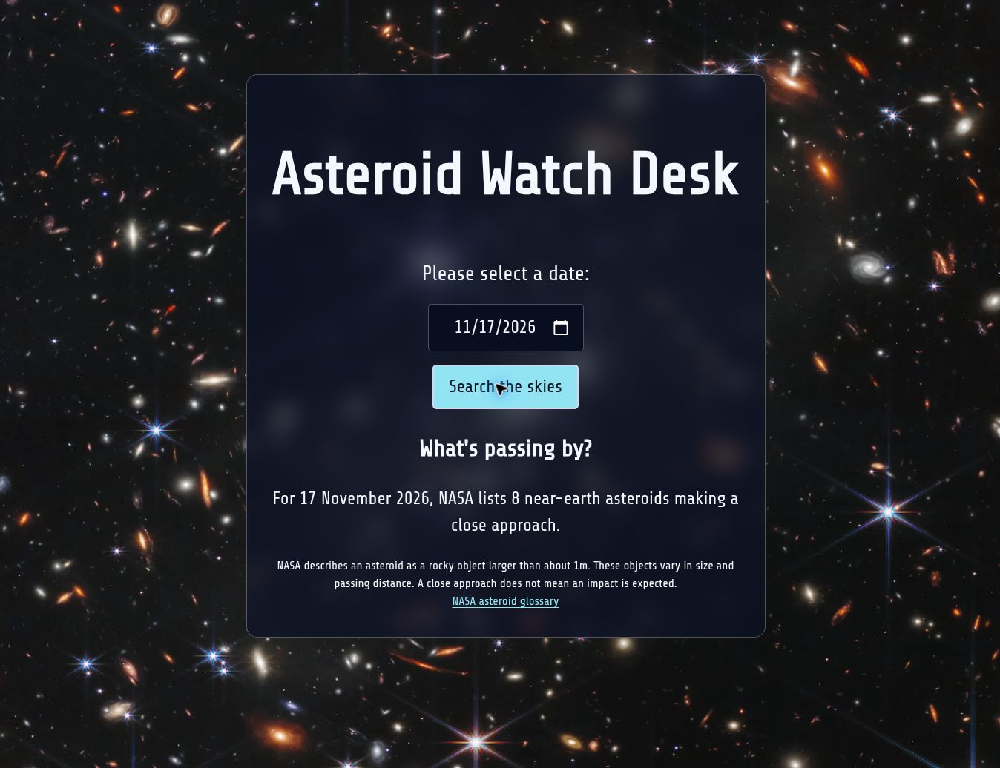
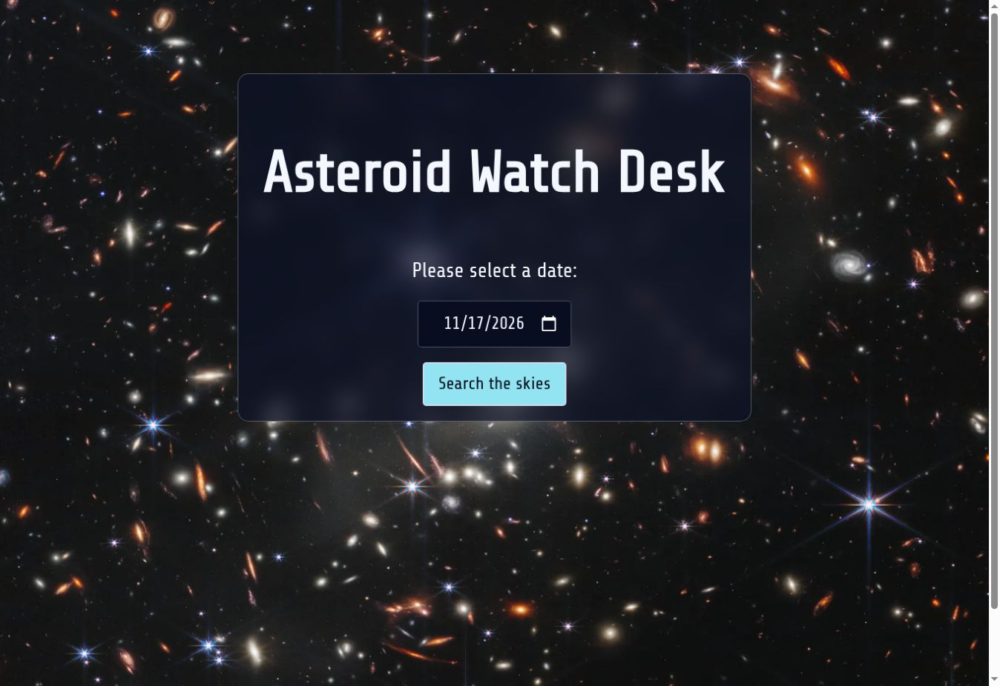

# Asteroid Watch Desk

Pick a date and see how many near-Earth asteroids NASA lists as making a close approach that day.

**[Try the live demo](https://asteroid-watch-desk.netlify.app/)**



## Try a lookup

1. Open the live demo and choose a date.
2. Select **Search the skies**.
3. The result shows the count for that date, alongside a short note about what a close approach means.

<details>
<summary>See the date form before a search</summary>



</details>

## How it works

1. The browser sends the selected date to `/.netlify/functions/asteroids` using Axios.
2. The Netlify Function reads `NASA_API_KEY` from its environment and requests near-Earth object data from [NASA's API](https://api.nasa.gov/).
3. The function returns the date and count. The browser formats the date, displays the result and shows a message if the request fails.

The function keeps the NASA key on the server. The browser only needs to send a date.

## Project files

| Path | Purpose |
| --- | --- |
| `public/index.html` | Date form and result area |
| `public/src/script.js` | Form submission, request and result display |
| `public/src/styles.css` | Page and form styling |
| `netlify/functions/asteroids.mjs` | Server-side request to NASA |

Built with HTML, CSS, JavaScript, Axios and Netlify Functions.

## Run it locally

You’ll need [Node.js](https://nodejs.org/) and a [NASA API key](https://api.nasa.gov/).

1. Clone or download this repository.
2. In the repository root (alongside `public` and `netlify`), create a `.env` file and put your own key after `NASA_API_KEY=`. Keep `.env` local.
3. From the repository root, start Netlify Dev:

   ```sh
   npx netlify-cli dev --dir=public
   ```

   In Windows PowerShell, use `npx.cmd netlify-cli dev --dir=public` if PowerShell blocks `npx.ps1`.

4. Open the local URL printed in the terminal and try a lookup.
